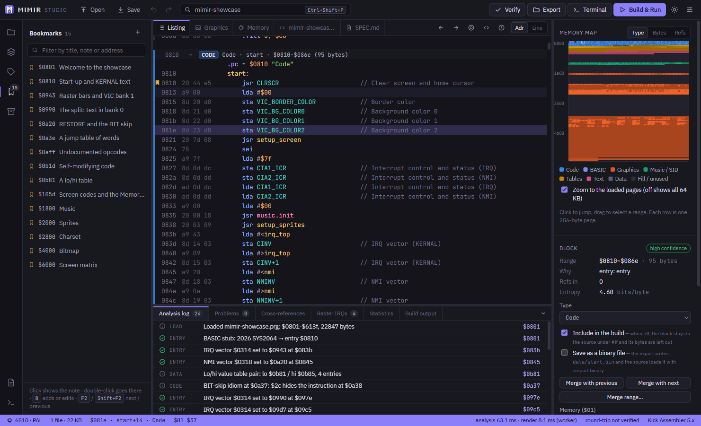
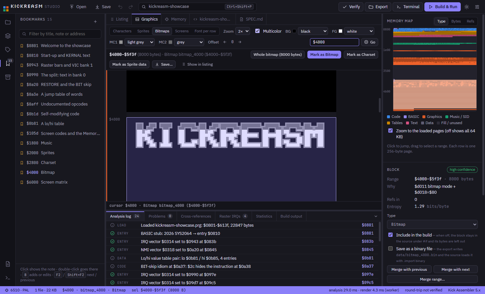

# KickReasm Studio

**Turn Commodore 64 programs back into source code you can read, change and rebuild.**

KickReasm Studio is a desktop IDE for re-assembling C64 software. Open a `.prg`, a `.d64` disk image or a VICE
snapshot. The app traces the code, recognises graphics, music, tables and text, and names every hardware register
and KERNAL routine. You can then rename, comment and re-type anything. It exports a
[Kick Assembler](http://theweb.dk/KickAssembler/) project that assembles back to **exactly the same bytes**, and starts
it in [VICE](https://vice-emu.sourceforge.io/) with one key.



## What makes it different

- **A byte-exact round trip, checked every time.** The exported source is assembled again, by a built-in Kick
  Assembler subset and also by the real `KickAss.jar` when it is installed, and compared byte for byte with the
  original. `F7` verifies at any moment, and the status bar shows the result.
- **It follows the memory configuration.** The analysis tracks `$01` and the VIC bank along every code path, the
  `$dd02` trick included. So `sta $d020` reads `VIC_BORDER_COLOR` where I/O is banked in, and a RAM label where it is
  banked out.
- **VICE snapshots open like programs.** A `.vsf` file, or `F9` for VICE's quicksave, gives the RAM, the PC, the live
  interrupt vectors and `$01` as the starting point. *Build & Run* puts your rebuilt program into the snapshot and
  restarts it exactly where it was.
- **It recognises what demos and games are made of:**
  - SID players, by their jump table and note frequency table, exported as a `.sid` that Kick Assembler loads with `LoadSid`;
  - charsets, sprites, bitmaps and screens, from `$d018`, `$dd00` and the sprite pointers;
  - lo/hi pointer tables, sine tables, colour tables and text;
  - timing code: a branch that a CIA timer or the raster points into a delay (a stable raster), marked as a delay,
    with no labels for what its instructions only read to take time;
  - routines nothing traced reaches, such as an init that ran before a snapshot was taken;
  - fast loaders: Spindle, Krill's loader, Bitfire, Sparkle, the Covert Bitops loader, and any other one by its drive
    code;
  - packed programs, which the bundled unp64 unpacks with one click.
- **A deep analysis that works the problems down.** Tick *Deep analysis* in the Problems tab. Every guess (a routine
  nothing traced reaches, a pointer-table target, an interrupt handler) is then traced on trial and kept only when it
  leads to no problem. Calls into ROM are not followed into the RAM below, and `$01` is followed through the stack.
  It analyses again until nothing changes, and the log says what it left out. On 1060 real programs the problems fall
  from 4054 to 620, at four to five times the analysis time.
- **A list of all raster IRQs.** Every interrupt handler appears with the raster line it runs at (`$d012`, and bit 8
  from `$d011`), who sets it and where.
- **A Graphics tab.** It shows all 64 KB as characters, sprites, bitmaps, screens or a font per character row. You
  select what you find, mark it and save it as raw bytes, a `.prg`, a Koala or Art Studio picture, a PNG or `.byte`
  source.
- **A Memory tab.** It prints memory the way the VICE monitor does (`m`, `i`, `ii`). You can search it for text, as
  PETSCII and as screen codes at once, or for bytes (`a9 00 8d`, `??` for any byte), and step through the hits.
- **Every edit still assembles, and every edit can be undone:**
  - rename labels and comment lines;
  - mark ranges as code, bytes, words or text, and write data, tables and words in hex, decimal or binary, as many
    a row as you like;
  - merge blocks, or drag a byte into the block next to it;
  - set the memory configuration for a range, keep bookmarks and fold blocks;
  - leave blocks out of the build, or save them as binary files.
- **The toolchain is built in:** Kick Assembler builds, VICE (`F5`), Exomizer packing in the *Pack* view, and a
  terminal with the tools on its `PATH`.



## Getting started

### Requirements

- Windows 10 or 11. The app is built with Electron, and the installer is made for Windows.
- [Node.js](https://nodejs.org/) 22.12 or newer and [pnpm](https://pnpm.io/) 9 (`corepack enable pnpm`).
- Optional: Java and Kick Assembler (`KickAss.jar`), to build the exported projects and to verify against the real
  assembler.
- Optional: VICE (`x64sc`), for *Build & Run*.

The app finds `KickAss.jar` and `x64sc` in the usual folders (for example `C:\C64\...`). You can change them in
**Settings → Toolchain**.

### Run it from source

```bash
pnpm install
```

```bash
pnpm dev
```

### Build the installer

```bash
pnpm --filter @kickreasm/desktop package
```

This writes `KickReasm-Studio-<version>-setup.exe` and a portable `.exe` to `apps/desktop/release/<version>/`.

## How to use it

1. **Open a program.** Use *Open PRG…* (`Ctrl+O`) for a `.prg` or a VICE `.vsf`, or *Mount D64…* for a disk. You can
   also drop the file on the window. *Demo* in the Explorer loads a showcase with a guided tour (`F2`).
2. **Read the listing.** Blocks are coloured by type. The inspector on the right shows why each block was classified
   the way it was, the memory map and a preview. `G` goes to an address or label, and `X` lists who references the
   line.
3. **Fix what the heuristics got wrong.** `N` renames, `;` comments, and `C`, `D`, `W` and `T` mark the selection as
   code, bytes, words or text. Right-click for everything else. `Ctrl+Z` undoes, and `Ctrl+C` copies the selected
   lines as source.
4. **Verify** with `F7`. The status bar says whether the source assembles back to the original bytes.
5. **Export** the Kick Assembler project with its build scripts (`Ctrl+E`), or **Build & Run** it in VICE (`F5`).

The bottom panel holds the analysis log, problems (with the *Deep analysis* switch), cross-references, the raster IRQs,
statistics and the build output.

### Command line

The analysis also runs without the app, for batch jobs and CI:

```bash
pnpm kickreasm analyse game.prg
```

`analyse`, `verify [--kickass]`, `export -o <folder>` and `demo` take `.prg` files or saved projects (`.krproj.json`).
`--deep` runs the deep analysis.

## Project layout

| Folder | What is in it |
|---|---|
| `packages/core` | the analysis, the Kick Assembler output and the verification (TypeScript, no UI and no I/O) |
| `packages/cli` | the command-line front end |
| `apps/desktop` | the Electron app (React), with its end-to-end tests |
| `fixtures` | small test programs that the project builds itself |
| `docs` | [the specification](docs/spec.md) (in Swedish) and [the development notes](docs/DEVELOPMENT.md) |

### Tests

```bash
pnpm test
```

This runs the unit, round-trip, fuzz and differential tests of every package. `pnpm typecheck` type-checks them, and
`pnpm --filter @kickreasm/desktop e2e` runs the end-to-end tests against the built app.
[docs/DEVELOPMENT.md](docs/DEVELOPMENT.md) describes every test.

## Third-party tools

The installer includes two tools, unchanged from their own releases, from `apps/desktop/vendor/`:

- unp64 2.40 by [iAN CooG](http://iancoog.altervista.org), the generic C64 unpacker;
- Exomizer 3.1.1 by Magnus Lind, the cruncher.

Their licence lets anyone distribute them freely for **non-commercial, non-profit** use, as long as their notices
(`unp64.txt`, `LICENSE.txt`) stay with them. Do not sell a build that includes them. Kick Assembler, Java and VICE are
not included: install them yourself.

## License

KickReasm Studio is free software: you can redistribute it and/or modify it under the terms of the
[GNU General Public License, version 3](LICENSE) (GPL-3.0-only). It is distributed in the hope that it will be useful,
but without any warranty; see the license for details.

The bundled unp64 and Exomizer are separate programs under their own licence (see above), which the GPL does not
change.
