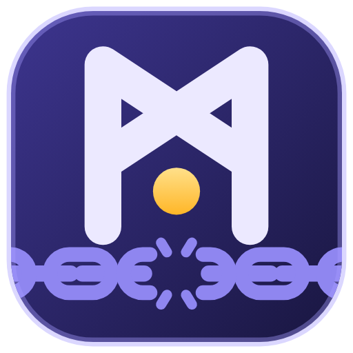

<p align="center"></p>

# Mimir Studio

**Turn Commodore 64 programs back into source code you can read, change and rebuild.**

*Named after Mímir, who keeps the well of wisdom in Norse myth; the logo is his rune ᛗ glowing over the rings of his well.*

Mimir Studio is a desktop IDE for re-assembling C64 software. Open a `.prg`, a `.d64` disk image or a VICE
snapshot. The app traces the code, recognises graphics, music, tables and text, and names every hardware register
and KERNAL routine. You can then rename, comment and re-type anything. It exports a
[Kick Assembler](http://theweb.dk/KickAssembler/) project that assembles back to **exactly the same bytes**, and starts
it in [VICE](https://vice-emu.sourceforge.io/) with one key.


## What makes it different

- **A byte-exact round trip, checked every time.** The exported source is assembled again, by a built-in Kick
  Assembler subset and also by the real `KickAss.jar` when it is installed, and compared byte for byte with the
  original. `F7` verifies at any moment, and the status bar shows the result.
- **It follows the memory configuration.** The analysis tracks `$01` and the VIC bank along every code path, the
  `$dd02` trick included. So `sta $d020` reads `VIC_BORDER_COLOR` where I/O is banked in, and a RAM label where it is
  banked out.
- **VICE snapshots open like programs.** A `.vsf` file, or `F9` for VICE's quicksave, gives the RAM, the PC, the live
  interrupt vectors and `$01` as the starting point. *Build & Run* puts your rebuilt program into the snapshot and
  restarts it exactly where it was. The newest 5 quicksaves are kept in a list, where you can name them, open them and
  save them to a folder of your own. A star makes one a favourite, which stays when VICE saves newer ones.
- **It recognises what demos and games are made of:**
  - SID players, by their jump table and note frequency table, exported as a `.sid` that Kick Assembler loads with `LoadSid`;
  - charsets, sprites, bitmaps and screens, from `$d018`, `$dd00` and the sprite pointers;
  - lo/hi pointer tables, sine tables, colour tables and text;
  - timing code: a branch that a CIA timer or the raster points into a delay (a stable raster), marked as a delay,
    with no labels for what its instructions only read to take time. Spindle's jitter correction, which subtracts
    the timer from a constant, is one too;
  - routines nothing traced reaches, such as an init that ran before a snapshot was taken;
  - fast loaders: Spindle, Krill's loader, Bitfire, Sparkle, the Covert Bitops loader, and any other one by its drive
    code;
  - packed programs, which [Sindri](https://github.com/MikaelEriksson072/Sindri), Mimir's own unpacker, unpacks with one
    click: it runs the program in an emulated C64, reports each layer it peels off (coders, movers, decrunchers) and
    names the packer by its fingerprint. A file opened from a mounted D64 gets that disk in an emulated 1541, so a boot
    file's fast loader (Bitfire, Krill's, Sparkle, Spindle and others) goes on loading the next part;
  - the script of a Spindle trackmo: Pefchain builds a small driver after each part from its line of the script, and
    Mimir reads the drivers in memory back into those lines (the part, its routines and the condition that ends it,
    such as `space` or `ed = 0b`). The *Spindle script* tab lists them, and *Copy script* copies them as Pefchain reads
    them. A VICE snapshot of a running trackmo holds the parts that are loaded;
  - the load script of a Spindle 3 disk: Spin crunches each loader call's files onto the disk, and Mimir reads the
    jobs back, decrunched, so every chunk opens as a PRG at its address. *Copy script* copies the script as Spin
    reads it (the file names are not on the disk);
  - the files of a Bitfire disk: Bitfire has no load script, as each part loads the next file, but its disk keeps the
    files in a directory of their own in the order they load. The *Bitfire script* tab lists them, unpacked when bitnax
    (Bitfire 0.x) or dali (1.x) packed them, and *Copy script* copies the d64write command line that builds the disk.
- **A deep analysis that works the problems down.** Tick *Deep analysis* in the Problems tab. Every guess (a routine
  nothing traced reaches, a pointer-table target, an interrupt handler) is then traced on trial and kept only when it
  leads to no problem. Calls into ROM are not followed into the RAM below, and `$01` is followed through the stack.
  It analyses again until nothing changes, and the log says what it left out. On 1060 real programs the problems fall
  from 4054 to 620, at four to five times the analysis time.
- **A list of all raster IRQs.** Every interrupt handler appears with the raster line it runs at (`$d012`, and bit 8
  from `$d011`), who sets it and where.
- **A Graphics tab.** It shows all 64 KB as characters, sprites, bitmaps, screens or a font per character row. You
  select what you find, mark it and save it as raw bytes, a `.prg`, a Koala or Art Studio picture, a PNG or `.byte`
  source.
- **A Memory tab.** It prints memory the way the VICE monitor does (`m`, `i`, `ii`). You can search it for text, as
  PETSCII and as screen codes at once, or for bytes (`a9 00 8d`, `??` for any byte), and step through the hits.
- **Every edit still assembles, and every edit can be undone:**
  - rename labels and comment lines;
  - mark ranges as code, bytes, words or text, and write data, tables and words in hex, decimal or binary, as many
    a row as you like;
  - merge blocks, or drag a byte into the block next to it;
  - set the memory configuration for a range, keep bookmarks and fold blocks;
  - leave blocks out of the build, or save them as binary files.
- **Patches.** Select lines and press `P` to write new code over them, in Kick Assembler with the program's labels and
  the hardware names. The editor shows each line's address and bytes as you type, `Tab` steps from instruction to
  instruction, and an original instruction you write over moves to a column on the right, out of the code. The code
  can be shorter (NOPs fill the rest) but not longer, unless you choose to overwrite past the range. With *Keep the
  cycle count* it must take as many cycles as the original, with instructions of a fixed time or the same varying
  ones the original has (a `bne` for a `bne`), and the editor shows how many cycles are left. The listing marks the
  patched bytes. Each patch can be switched off and on in the Explorer, edited, removed (the original bytes come back)
  and saved as a PRG. The export writes each one's source to `patches/`, as a `.asm` file that assembles on its own.
- **Its own cruncher.** The *Pack* view packs the rebuilt program with [Brokkr](packages/brokkr/README.md), Mimir's own
  cruncher (Sindri's brother: Sindri unpacks, Brokkr packs). It writes Exomizer 3's format, so every Exomizer
  decruncher reads it, but crunches it smaller and several times faster than Exomizer 3.1.1, plans where the
  decruncher, its table and the stream go and what `$01` must be, and runs every self-extracting file in an emulated
  C64 before it hands it over. *Max* effort searches on every core. For the smallest files it has a format of its own,
  coded adaptively as LZMA is: 6.6 % less crunched data than Exomizer 3.1.1, decrunched about 8 times slower; for the
  fastest decrunching one of whole bytes: 13 % more, decrunched about twice as fast. Exomizer itself is still a choice.
  The view shows only the settings that work for the packer, format and kind of file you choose: what to pack, the
  packed file (format, effort, name, and a folder it is written to each time), then how a self-extracting file starts (start, `$01` and interrupts after, the
  border flash) or how crunched data loads, and the exact command it runs.
- **The toolchain is built in:** Kick Assembler builds, VICE (`F5`), Brokkr or Exomizer packing in the *Pack* view, and a
  terminal with the tools on its `PATH`.


## Getting started

### Requirements

- Windows 10 or 11. The app is built with Electron, and the installer is made for Windows.
- [Node.js](https://nodejs.org/) 22.12 or newer and [pnpm](https://pnpm.io/) 9 (`corepack enable pnpm`).
- Optional: Java and Kick Assembler (`KickAss.jar`), to build the exported projects and to verify against the real
  assembler.
- Optional: VICE (`x64sc`), for *Build & Run*.

The app finds `KickAss.jar` and `x64sc` in the usual folders (for example `C:\C64\...`). You can change them in
**Settings → Toolchain**.

### Run it from source

```bash
pnpm install
```

```bash
pnpm dev
```

### Build the installer

```bash
pnpm --filter @mimir/desktop package
```

This writes `Mimir-Studio-<version>-setup.exe` and a portable `.exe` to `apps/desktop/release/<version>/`.

## How to use it

1. **Open a program.** Use *Open PRG…* (`Ctrl+O`) for a `.prg` or a VICE `.vsf`, or *Mount D64…* for a disk. You can
   also drop the file on the window. *Demo* in the Explorer loads a showcase with a guided tour (`F2`).
2. **Read the listing.** Blocks are coloured by type. The inspector on the right shows why each block was classified
   the way it was, the memory map and a preview. `G` goes to an address or label, and `X` lists who references the
   line. Pointing at an undocumented opcode says what it does and which flags it changes.
3. **Fix what the heuristics got wrong.** `N` renames, `;` comments, and `C`, `D`, `W` and `T` mark the selection as
   code, bytes, words or text. Right-click for everything else. `Ctrl+Z` undoes, and `Ctrl+C` copies the selected
   lines as source.
4. **Verify** with `F7`. The status bar says whether the source assembles back to the original bytes.
5. **Export** the Kick Assembler project with its build scripts (`Ctrl+E`), or **Build & Run** it in VICE (`F5`).

The bottom panel holds the analysis log, problems (with the *Deep analysis* switch), cross-references, the raster IRQs,
the Spindle script (when there is one), statistics and the build output.

### Command line

The analysis also runs without the app, for batch jobs and CI:

```bash
pnpm mimir analyse game.prg
```

`analyse`, `verify [--kickass]`, `export -o <folder>` and `demo` take `.prg` files or saved projects (`.mimir.json`).
`--deep` runs the deep analysis. `unpack game.prg [-o unpacked.prg]` unpacks a packed program and prints its layers; `unpack demo.d64` takes the disk's
first PRG (or `--file NAME`) with the disk in the drive.

## Project layout

| Folder | What is in it |
|---|---|
| `packages/core` | the analysis, the Kick Assembler output and the verification (TypeScript, no UI and no I/O) |
| `packages/cli` | the command-line front end |
| `packages/sindri` | Sindri, the unpacker: an emulated C64 that follows a packed program through its layers (TypeScript, [its README](packages/sindri/README.md)) |
| `packages/brokkr` | Brokkr, the cruncher: Exomizer 3 streams crunched smaller, self-extracting files, D64 packing and a 6502 decruncher (TypeScript, [its README](packages/brokkr/README.md)) |
| `apps/desktop` | the Electron app (React), with its end-to-end tests |
| `fixtures` | small test programs that the project builds itself |
| `docs` | [the specification](docs/spec.md) (in Swedish) and [the development notes](docs/DEVELOPMENT.md) |

### Tests

```bash
pnpm test
```

This runs the unit, round-trip, fuzz and differential tests of every package. `pnpm typecheck` type-checks them, and
`pnpm --filter @mimir/desktop e2e` runs the end-to-end tests against the built app.
[docs/DEVELOPMENT.md](docs/DEVELOPMENT.md) describes every test.

## Third-party tools

The installer includes one tool, unchanged from its own release, from `apps/desktop/vendor/`: Exomizer 3.1.1 by
Magnus Lind, a cruncher the Pack view can use instead of Brokkr. Its licence lets anyone distribute it freely for **non-commercial, non-profit** use, as long
as its notice (`LICENSE.txt`) stays with it. Do not sell a build that includes it. Kick Assembler, Java and VICE are
not included: install them yourself.

Packed programs are unpacked by Sindri, Mimir's own unpacker (`packages/sindri`, GPL-3.0 like the rest). It is a copy
of its own repository, [MikaelEriksson072/Sindri](https://github.com/MikaelEriksson072/Sindri), where it also runs on its
own from the command line. It uses the C64 ROMs of your VICE when it finds them, and small stand-ins for the KERNAL and
BASIC without them; for a disk it takes the 1541's DOS ROM from VICE too. unp64 by
[iAN CooG](http://iancoog.altervista.org) no longer comes with the app; it can still be set as an external unpacker in
Settings → Toolchain.

Programs are packed by Brokkr, Mimir's own cruncher (`packages/brokkr`, GPL-3.0 like the rest), a copy of its own
project, which also runs on its own from the command line. It writes the stream format of Exomizer 3 (whose decrunchers
read it) with code of its own: its cruncher, its 6502 decruncher and its self-extracting files are written from scratch.

## License

Mimir Studio is free software: you can redistribute it and/or modify it under the terms of the
[GNU General Public License, version 3](LICENSE) (GPL-3.0-only). It is distributed in the hope that it will be useful,
but without any warranty; see the license for details.

The bundled Exomizer is a separate program under its own licence (see above), which the GPL does not change.
